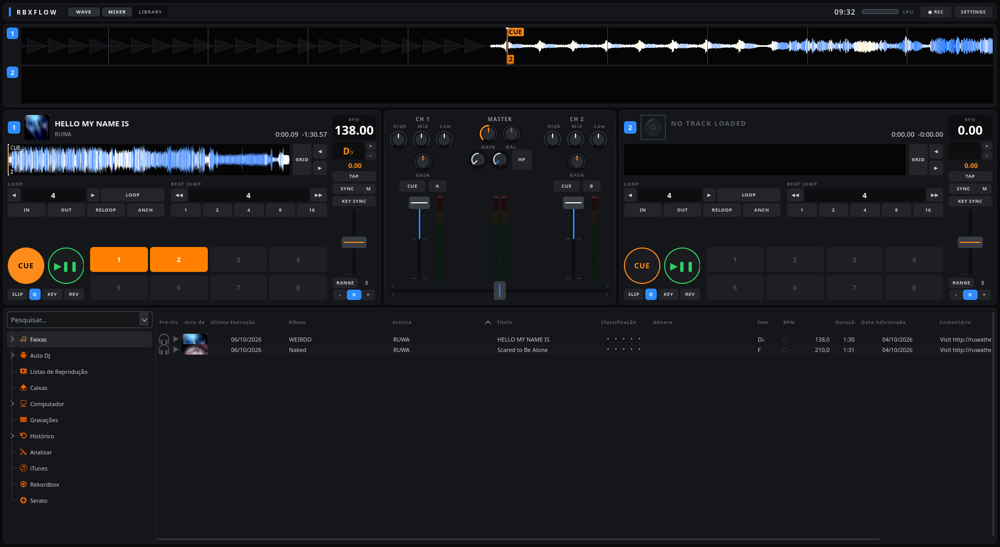
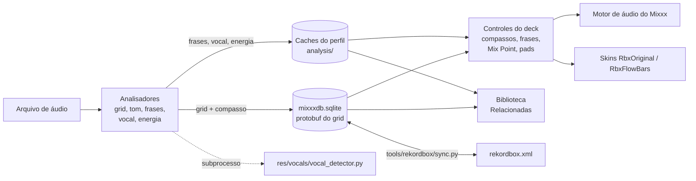

<p align="center">
  
</p>

# VILELABOX

Ambiente de DJ experimental construído sobre o [Mixxx](https://mixxx.org) 2.5.6,
com foco em compassos, frases musicais e edição de grid, e com interface e fluxo
de trabalho inspirados no rekordbox. O nome de código é **blackmesa** (ícone e
caches); o executável continua sendo `build/mixxx`.

A meta de longo prazo é transformar o projeto em um aplicativo desktop
independente, escrito progressivamente em [Rust](https://www.rust-lang.org).
**Hoje o projeto é um mod do Mixxx em C++/Qt.** O único código Rust é a ponte
`rekordbox.xml` em `rust/`, experimental: testada só com bancos de teste.

> Projeto experimental e não oficial. Não tem relação com a equipe do Mixxx nem
> com a AlphaTheta (rekordbox, Pioneer DJ). rekordbox é marca da AlphaTheta
> Corporation.

Repositório: <https://github.com/Thiagovilela2001/VILELABOX>

---

## Sumário

- [Visão geral](#visão-geral)
- [Estado atual](#estado-atual)
- [Funcionalidades](#funcionalidades)
- [Capturas de tela](#capturas-de-tela)
- [Arquitetura técnica](#arquitetura-técnica)
- [Tecnologias e dependências](#tecnologias-e-dependências)
- [Instalação e execução](#instalação-e-execução)
- [Estrutura de diretórios](#estrutura-de-diretórios)
- [Plano de desenvolvimento](#plano-de-desenvolvimento)
- [Testes e validação](#testes-e-validação)
- [Contribuições](#contribuições)
- [Licença e atribuições](#licença-e-atribuições)
- [Próximos passos](#próximos-passos)

---

## Visão geral

### Problema

O Mixxx é um software de DJ livre e completo, mas não organiza a faixa por
compassos e frases musicais da forma que DJs acostumados ao rekordbox esperam:
contagem `compasso:tempo`, grid fácil de corrigir, frases rotuladas (intro,
refrão, saída), cues gerados a partir da estrutura da música e sugestões de
faixas compatíveis. O VILELABOX adiciona esses recursos ao motor do Mixxx, com
skins que seguem a organização visual do rekordbox.

### Público

- **DJs** que usam Linux e querem preparar e tocar sets com grid, compassos e
  frases visíveis, num layout familiar para quem vem do rekordbox.
- **Desenvolvedores** interessados em análise musical (grid, downbeat, frases,
  vocal) e na futura reescrita em Rust.

### Relação com o Mixxx e com o rekordbox

- **Mixxx:** o repositório é um fork do Mixxx 2.5.6 (commit upstream
  `3ebac449e7`, "Release 2.5.6") com o histórico completo preservado. Os
  recursos próprios estão nos commits posteriores (`git log 3ebac449e7..HEAD`). O README original do Mixxx
  está em [README.mixxx.md](README.mixxx.md).
- **rekordbox:** é usado como catálogo de funções, formato de troca (XML) e
  referência de layout. Nenhum arquivo, modelo ou código do rekordbox é
  distribuído ou executado. Detalhes em
  [Como o VILELABOX usa o rekordbox](#como-o-vilelabox-usa-o-rekordbox).

### Objetivo em Rust

A intenção é separar progressivamente a lógica musical (compassos, grid,
frases, biblioteca) da infraestrutura do Mixxx e reescrevê-la em Rust, até
chegar a um aplicativo independente. **Esse objetivo ainda não tem código nem
plano técnico detalhado no repositório**; a seção
[Plano de desenvolvimento](#plano-de-desenvolvimento) descreve a proposta.

---

## Estado atual

| Aspecto | Situação |
| --- | --- |
| Base | Mixxx 2.5.6 (C++20, Qt 6, CMake) |
| Código próprio | 31 commits e cerca de 395 arquivos alterados ou criados em relação ao 2.5.6 (outubro de 2026) |
| Plataforma | Linux. Scripts em bash; CI do mod configurado para Ubuntu 22.04 |
| Windows e macOS | Sem registro de build ou teste do mod |
| Testes automatizados | Testes C++ (gtest) por módulo e testes Python, com áudio sintético |
| Validação em uso real | **Pendente** para todos os módulos (ver [Testes e validação](#testes-e-validação)) |
| Rust | Objetivo de longo prazo; `rust/vilelabox-rekordbox` experimental (testes e equivalência com `sync.py` em banco de teste) |

**Implementado (código e testes automatizados no repositório):** compassos,
painel de grid e detector de grid, faixa de BPM preferida, menu de tonalidade,
detector de vocal, análise de frases, cues automáticos, Mix Point Link, faixas
relacionadas, pads na tela, janela de configurações, waveform RGB, skins
`RbxOriginal` e `RbxFlowBars` e ponte XML com o rekordbox.

**Em desenvolvimento:** validação com músicas reais e no dispositivo de áudio
(roteiro em [VALIDACAO.md](VALIDACAO.md), ainda não preenchido) e correção
manual de frases (aguarda decisão de projeto, ver [PLANO-3.md](PLANO-3.md)).

**Planejado ou adiado:**

- Stems / isolamento de partes: adiado; depende de migrar para o Mixxx 2.6.
- Mapeamento de controladoras: fora do escopo atual, por decisão registrada.
- Aplicativo independente em Rust: objetivo de longo prazo.

**Diferença entre o estado atual e o destino:** hoje todos os recursos vivem
dentro do executável do Mixxx, acoplados ao motor de áudio, à biblioteca SQLite
e ao sistema de skins dele. A arquitetura de destino separa esses recursos em
módulos próprios em Rust (ver [Arquitetura técnica](#arquitetura-técnica)).

---

## Funcionalidades

Cada recurso tem um documento próprio com controles, uso, limites e testes. Em
todos, os testes automatizados passam por registro em
[IMPLEMENTACAO.md](IMPLEMENTACAO.md), mas **a validação auditiva e visual com
músicas reais ainda não foi feita**.

| Recurso | O que faz | Documento |
| --- | --- | --- |
| **Compassos** | Contagem `compasso:tempo` em 4/4, linhas de compasso e de frase (8 compassos) na waveform e no overview, compasso 1 automático, SET 1 manual, sync por compasso ao dar PLAY, saltos e loops de N compassos | [COMPASSOS.md](COMPASSOS.md) |
| **Grid** | Painel de edição por deck (GRID, deslocar, SET 1, LOCK, BPM ±0,01, TAP, ½×, 2×, UNDO), detector "VILELABOX — Grid preciso e primeiro tempo" (Queen Mary refinado), modos de BPM fixo e variável e faixa de BPM preferida | [GRID.md](GRID.md) |
| **Tonalidade** | Menu no cabeçalho do deck: trava de tom, ±1 semitom, voltar ao tom original e escolher a tônica diretamente | [TONALIDADE.md](TONALIDADE.md) |
| **Vocal** | Detector de presença de voz (Demucs quando instalado, ou um classificador pequeno próprio), mostrado como faixa rosa na waveform e indicador VOCAL / SEM VOZ | [VOCALS.md](VOCALS.md) |
| **Frases** | Segmentação em Intro, Up, Chorus, Down, Verse e Outro, alinhada aos compassos; PhraseSync opcional. Rótulos heurísticos | [FRASES.md](FRASES.md) |
| **Cues automáticos** | Cues de faixa Intro/Outro e hot cues MIX IN, DROP, BREAK, DROP 2 e MIX OUT gerados a partir das frases, só em slots vazios, com desfazer | [CUES.md](CUES.md) |
| **Mix Point Link** | Arma o deck parado para começar sozinho quando o outro deck chega ao ponto de saída, com pontos automáticos e disparo alinhado ao drop | [MIXPOINT.md](MIXPOINT.md) |
| **Faixas relacionadas** | Seção na biblioteca que sugere faixas por tom compatível (Camelot), BPM (±6%, com metade e dobro) e uma nota de energia própria | [RELACIONADAS.md](RELACIONADAS.md) |
| **Pads na tela** | Slicer, KeyShift, Keyboard e Release FX (BREAK, ECHO, SPIN), em painel opcional na skin | [PADS.md](PADS.md) |
| **Configurações** | Janela de preferências com categorias, abas, busca, painéis das skins e opções do mod; também liga o modo RGB da waveform | [CONFIGURACOES.md](CONFIGURACOES.md) |
| **Skins** | `RbxOriginal` (dois decks no estilo do modo Performance) e `RbxFlowBars` (gráficos gerados por scripts próprios) | [res/skins/](res/skins/) |
| **Ponte XML** | Exporta e importa faixas, hot cues, loops, grid e playlists em `rekordbox.xml` | Sem documento próprio; uso na docstring de [tools/rekordbox/sync.py](tools/rekordbox/sync.py) |

### Por área

- **Interface e fluxo de trabalho:** duas skins próprias. A `RbxFlowBars`
  segue o fluxo biblioteca → preparar faixa → decks → mixer → performance. Os
  recursos novos são acionados por botões nas skins.
- **Biblioteca e playlists:** a biblioteca é a do Mixxx. O mod acrescenta a
  seção "Relacionadas" e opções no menu da faixa (reanalisar frases, modo de
  grid). Não há recursos novos de playlist dentro do aplicativo; playlists
  entram e saem pela ponte XML.
- **BPM, tonalidade e beatgrid:** detector de grid próprio baseado no Queen
  Mary, faixa de BPM preferida (padrão 78–155), painel de edição do grid e menu
  de tonalidade sobre o motor de pitch do Mixxx.
- **Hot cues, loops e preparação de sets:** cues automáticos por frase, loops de
  N compassos, Slicer, Mix Point Link e faixas relacionadas. Não há editor novo
  de hot cues.
- **Controladoras MIDI:** **nenhuma controladora foi mapeada** e o código de
  controladoras do Mixxx não foi alterado. O suporte MIDI/HID existente do Mixxx
  continua disponível, mas os controles novos do mod não têm mapeamento.
- **Rekordbox:** ponte XML própria (veja abaixo). A leitura de pendrives
  exportados pelo rekordbox (`lib/rekordbox-metadata/`) é recurso do Mixxx,
  mantido sem alterações.

### Compatibilidade com o Mixxx original

- **O banco de dados não muda de esquema.** O `mixxxdb.sqlite` continua abrindo
  num Mixxx sem o mod.
- **A referência de compasso fica no protobuf do grid**, num campo novo. Um
  Mixxx sem o mod ignora esse campo; reanalisar ou regravar o grid nele pode
  apagá-lo.
- **Frases, vocal e energia ficam em caches separados**, dentro do perfil
  (`analysis/phrases/`, `analysis/vocals/`, `analysis/blackmesa.sqlite`).
- **Os controles novos só existem neste executável.** Abrir as skins no Mixxx
  oficial carrega o layout, mas os botões do mod ficam sem efeito.
- **As análises pesadas e as automações começam desligadas:** análise de frases,
  análise de energia, cues automáticos e PhraseSync precisam ser ativados. Os
  demais recursos (compassos, painel de grid, menu de tom, pads) ficam
  disponíveis pelas skins do mod.

### Como o VILELABOX usa o rekordbox

O rekordbox entra no projeto de três formas. **Nenhum arquivo do rekordbox é
distribuído aqui e nenhum código ou modelo dele é executado.**

**1. Como catálogo de recursos.** Um instalador do rekordbox foi examinado
localmente, sem executar o programa, para saber quais funções existem: os
mapeamentos MIDI (`MidiMappings/*.midi.csv`), a lista de modos de pad
(`pad/*.pad.csv`) e os nomes dos ícones da interface. Cada recurso foi
implementado do zero sobre o motor do Mixxx:

| Função no rekordbox | Implementação no VILELABOX |
| --- | --- |
| `GridAdjust`, `GridSlide`, `GridAdjustHalf/Double`, ícones `Grid_Button_*` | Painel de grid ([GRID.md](GRID.md)) |
| `MasterTempo`, `SemitoneUp/Down`, `KeyReset`, `KeySync` | Menu de tonalidade ([TONALIDADE.md](TONALIDADE.md)) |
| `PhraseSync` | Análise de frases e PhraseSync ([FRASES.md](FRASES.md)) |
| `MixPointLink`, `MixPointLinkSilent`, `MixPointSelectNext/Prev` | Mix Point Link ([MIXPOINT.md](MIXPOINT.md)) |
| `RelatedTracks`, ícones de sugestão de faixas | Faixas relacionadas ([RELACIONADAS.md](RELACIONADAS.md)) |
| Modos de pad `Slicers`, `KeyShift`, `Keyboard`, `*ReleaseFX*` | Pads na tela ([PADS.md](PADS.md)) |
| Detecção de vocal da waveform | Detector de vocal ([VOCALS.md](VOCALS.md)) |

Os algoritmos são próprios ou vêm de projetos abertos (Queen Mary, para o grid).
Os resultados **não são equivalentes** aos do rekordbox e não há essa alegação.

**2. Como formato de troca.** [tools/rekordbox/sync.py](tools/rekordbox/sync.py)
lê e escreve o XML de coleção do rekordbox (`COLLECTION`, `DJ_PLAYLISTS`) com os
subcomandos `export`, `import` e `status`. A importação recusa rodar com o Mixxx
aberto, bloqueia escritores concorrentes, faz backup consistente do banco
(incluindo WAL) e desfaz tudo se falhar. Há quatro testes unitários; **a ponte
ainda não foi testada contra um rekordbox real**.

**3. Como referência visual.** A skin `RbxOriginal` reproduz a disposição do
modo Performance (2 decks horizontais, jog, mixer central e biblioteca
embaixo). Os ícones dela (`res/skins/RbxOriginal/rb/`) são desenhos próprios.

**O que o projeto não faz:**

- **Não usa os modelos do rekordbox** (redes de grid, downbeat, cues, stems e
  vocal). Nenhum é incluído, carregado ou convertido. O script que fazia isso
  foi aposentado ([tools/rekordbox/analyze_ml_retired.py](tools/rekordbox/analyze_ml_retired.py)).
- **Não copia arte, samples, mapeamentos nem binários do instalador.**
  [tools/check-third-party-assets.sh](tools/check-third-party-assets.sh)
  compara os arquivos versionados com os do instalador e falha se encontrar uma
  cópia. Ele exige o instalador extraído localmente, por isso não roda no CI.
- **Não faz engenharia reversa de algoritmos.**

---

## Capturas de tela

Skin `RbxFlowBars`, versão "pass 4 flat" (outubro de 2026), em 1920×1080:



Outras capturas da evolução dessa skin, incluindo comparações de antes e
depois, estão em [res/skins/RbxFlowBars/docs/](res/skins/RbxFlowBars/docs/).
Essa captura é anterior aos commits mais recentes (por exemplo, a nova janela de
configurações e o modo RGB) e pode não refletir todos os detalhes atuais.

Ainda não há capturas da skin `RbxOriginal`, dos painéis de grid e de frases
nem da waveform RGB. Elas serão adicionadas após a validação visual.

---

## Arquitetura técnica

### Arquitetura atual (C++/Qt, dentro do Mixxx)

O VILELABOX não tem um núcleo separado: cada recurso foi encaixado no
subsistema correspondente do Mixxx.

| Subsistema do Mixxx | Responsabilidade | Acréscimos do VILELABOX |
| --- | --- | --- |
| `src/engine/controls/` | Controles por deck no motor de áudio | `phrasecontrol`, `mixpointcontrol`, `padcontrol` (novos); alterações em `bpmcontrol` (compasso 1, sync por compasso, PhraseSync) e `loopingcontrol` (saltos e loops de compassos) |
| `src/analyzer/` | Pipeline de análise de faixas | `analyzerphrases`, `analyzervocals`, `analyzerenergy` e caches; detector de grid em `plugins/analyzerqueenmarybeats` |
| `src/track/`, `src/proto/` | Modelo de faixa e grid | referência de compasso em `track/beats` e `proto/beats.proto`; `phrases`, `mixpoints`, `autophrasecues`, `tempooctave.h` |
| `src/library/` | Biblioteca e seções laterais | `related/` (faixas relacionadas) |
| `src/waveform/`, `src/widget/` | Waveform, overview e widgets das skins | linhas de compasso e frase, faixa de vocal, modo RGB, `wphrasestatus`, `wvocalstatus`, menu de tom em `wkey` |
| `src/preferences/dialog/` | Janela de preferências | janela reorganizada e página `dlgprefvilelabox` |
| `res/skins/RbxOriginal`, `res/skins/RbxFlowBars` | Skins próprias | layout e botões de todos os recursos |
| `res/vocals/`, `tools/` | Scripts auxiliares em Python | detector de vocal, ponte XML, exportação de frases, verificação |

O fluxo de uma faixa, de forma simplificada:



### Arquitetura de destino em Rust (proposta)

Nada abaixo existe ainda. É a divisão proposta para o aplicativo independente:

| Módulo proposto | Responsabilidade |
| --- | --- |
| `vilelabox-core` | Estado dos decks, eventos e lógica musical |
| `vilelabox-library` | Biblioteca, playlists e metadados |
| `vilelabox-analysis` | BPM, beatgrid, frases e análise de áudio |
| `vilelabox-audio` | Reprodução e processamento de áudio |
| `vilelabox-rekordbox` | Importação, exportação e compatibilidade |
| `vilelabox-midi` | Integração com controladoras |
| `vilelabox-ui` | Interface gráfica |

A ordem natural de extração é das partes menos acopladas ao motor de áudio
(ponte XML, análise de frases, cálculo de relacionadas) para as mais acopladas
(motor, sincronização, interface).

---

## Tecnologias e dependências

### Usadas atualmente

| Componente | Papel |
| --- | --- |
| C++20, [CMake](https://cmake.org) ≥ 3.21 | Linguagem e build herdados do Mixxx |
| [Qt](https://www.qt.io) 6 (≥ 6.2) | Interface, eventos e utilitários. O CMake ainda aceita Qt 5 ≥ 5.12, mas o mod não foi testado com ele |
| SQLite | Biblioteca do Mixxx (`mixxxdb.sqlite`) e cache de energia (`blackmesa.sqlite`) |
| Protocol Buffers | Formato do grid, onde fica a referência de compasso |
| qm-dsp (Queen Mary) | Base do detector de grid |
| libebur128 | Loudness usado na nota de energia |
| SoundTouch, Rubber Band | Tempo e tom (motor do Mixxx) |
| PortAudio | Saída de áudio |
| TagLib, Chromaprint, FLAC, Ogg/Vorbis, LAME, libsndfile | Metadados e decodificação herdados do Mixxx |
| libkeyfinder + FFTW | Detecção de tom (opção `KEYFINDER`, ligada por padrão no CMake) |
| Python 3 com NumPy e SciPy | Detector de vocal ([res/vocals/vocal_detector.py](res/vocals/vocal_detector.py)) |
| [Demucs](https://github.com/facebookresearch/demucs) + PyTorch (opcional) | Motor preferido do detector de vocal; sem ele, usa o classificador de `res/vocals/model.json` |
| Python 3 (biblioteca padrão) | Ponte XML e exportação de frases |
| scikit-learn (só desenvolvimento) | Treino do classificador de vocal |

A lista completa e as dependências opcionais do Mixxx estão no
[CMakeLists.txt](CMakeLists.txt). O build do mod desliga a interface QML
experimental e a exportação Engine Prime (`-DQML=OFF -DENGINEPRIME=OFF`), o que
dispensa a libdjinterop.

### Previstas para a versão em Rust (não instaladas)

Alternativas em avaliação, sem decisão: [egui/eframe](https://github.com/emilk/egui)
ou [Slint](https://slint.dev) para a interface, [CPAL](https://github.com/RustAudio/cpal)
para áudio, [Lofty](https://github.com/Serial-ATA/lofty-rs) para metadados,
[rustfft](https://github.com/ejmahler/RustFFT) para análise espectral e SQLite
para a biblioteca.

---

## Instalação e execução

Só há procedimento documentado e usado para **Linux**. Não existe registro de
build do mod no Windows ou no macOS.

### Pré-requisitos (Linux)

- Dependências de compilação do Mixxx 2.5 com Qt 6. Em Debian/Ubuntu, o script
  herdado do Mixxx instala tudo via `apt` (pede `sudo`):

  ```bash
  tools/debian_buildenv.sh setup
  ```

  Referência: [guia oficial de compilação do Mixxx](https://github.com/mixxxdj/mixxx/wiki/Compiling-on-Linux).
  O `shell.nix` do repositório é herdado e ainda usa Qt 5; não está alinhado
  com o build do mod.
- Python 3 com NumPy e SciPy para o detector de vocal. O padrão é
  `~/.venv/bin/python`; outro interpretador pode ser indicado em
  `VILELABOX_VOCAL_PYTHON`. Demucs e PyTorch são opcionais.

- Ter aberto o Mixxx instalado ao menos uma vez, para existir o perfil
  `~/.mixxx` (com `mixxx.cfg`). O perfil de teste é copiado dele.

### Compilar

Clone em `~/.mixxx/mixxx-source`. Os scripts funcionam de qualquer pasta, mas o
perfil de teste é copiado do **diretório-pai do repositório**, que precisa ser
o `~/.mixxx`:

```bash
git clone https://github.com/Thiagovilela2001/VILELABOX ~/.mixxx/mixxx-source
cd ~/.mixxx/mixxx-source
bash build-bars.sh
```

O `build-bars.sh` configura o CMake em `build/` (`Release`, QML e Engine Prime
desligados, testes ligados), compila com 4 jobs e em seguida roda
`tools/verify-mod.sh --no-build`. Se alguma verificação obrigatória falhar, o
script termina com erro.

### Abrir

```bash
bash run-bars.sh    # perfil de teste separado (~/.mixxx/bars-profile)
bash run-mixxx.sh   # perfil principal (~/.mixxx)
```

- O `run-bars.sh` copia biblioteca, configurações, análises e efeitos do perfil
  principal para `bars-profile` na primeira execução, abre com a skin
  `RbxFlowBars` e não toca no principal. **Prefira este para experimentar.**
- **Faça backup de `~/.mixxx` antes de usar o `run-mixxx.sh`.** Ele usa a mesma
  biblioteca e configuração do Mixxx instalado e pode editar
  `~/.mixxx/mixxx.cfg` (renomeia a skin antiga `RbxFlow` para `RbxFlowBars`).
- Nada é instalado no sistema.
- Escolha a skin em **Preferências → Interface**: `RbxOriginal` ou
  `RbxFlowBars`.

### Ponte com o rekordbox

Com o Mixxx fechado:

```bash
python3 tools/rekordbox/sync.py export [arquivo.xml]   # Mixxx -> rekordbox.xml
python3 tools/rekordbox/sync.py import <arquivo.xml>   # rekordbox.xml -> Mixxx
python3 tools/rekordbox/sync.py status [arquivo.xml]
```

- O caminho padrão do XML é `~/mixxx-rekordbox/rekordbox.xml`.
- A ponte sempre usa o banco do **perfil principal** (`~/.mixxx/mixxxdb.sqlite`),
  nunca o `bars-profile`.

---

## Estrutura de diretórios

Apenas os itens principais. O que não está listado é herdado do Mixxx sem
alterações relevantes.

```text
VILELABOX/
├── README.md               # este documento
├── README.mixxx.md         # README original do Mixxx
├── COMPASSOS.md … CONFIGURACOES.md   # um documento por recurso (pt-BR)
├── PLANO.md, PLANO-2.md, PLANO-3.md  # planos de desenvolvimento
├── IMPLEMENTACAO.md        # registro da execução e dos testes
├── VALIDACAO.md            # roteiro de validação com músicas reais
├── build-bars.sh           # compila e verifica
├── run-bars.sh             # abre com perfil de teste
├── run-mixxx.sh            # abre com o perfil principal
├── prepare-bars-profile.py # cria o perfil de teste
├── CMakeLists.txt, cmake/  # build (Mixxx)
├── src/                    # código C++ (Mixxx + recursos do mod)
│   ├── analyzer/           # análise: grid, frases, vocal, energia
│   ├── engine/controls/    # controles de compasso, frase, Mix Point, pads
│   ├── track/              # grid, frases, mix points, cues automáticos
│   ├── library/related/    # faixas relacionadas
│   ├── preferences/dialog/ # janela de configurações
│   └── test/               # testes gtest (inclui os do mod)
├── lib/                    # bibliotecas de terceiros (sem alterações)
├── res/
│   ├── skins/RbxOriginal/  # skin própria
│   ├── skins/RbxFlowBars/  # skin própria (docs/ tem capturas)
│   └── vocals/             # detector de vocal e modelo pequeno
├── tools/
│   ├── verify-mod.sh       # verificação de todos os módulos
│   ├── verify/             # relatório e falhas conhecidas
│   ├── rekordbox/          # ponte XML e testes
│   ├── vocals/             # treino e validação do detector
│   ├── phrases/            # exportação de frases para anotação
│   └── check-third-party-assets.sh
├── packaging/blackmesa/    # ícone do build
└── .github/workflows/vilelabox.yml   # CI do mod
```

---

## Plano de desenvolvimento

O plano separa o que existe hoje (mod do Mixxx) da meta de longo prazo
(aplicativo em Rust). Cada etapa só começa quando a anterior cumpre seu
critério de conclusão.

| Etapa | Conteúdo | Critério de conclusão | Situação |
| --- | --- | --- | --- |
| 0. Validação do mod atual | Sessão com músicas reais seguindo [VALIDACAO.md](VALIDACAO.md); teste com buffers pequenos no dispositivo real | Tabelas de VALIDACAO.md preenchidas; meta de 80% dos limites de frase a até 1 compasso medida em 20 faixas anotadas | Pendente |
| 1. Inventário técnico | Mapear cada recurso do mod aos arquivos C++, testes e dependências do Mixxx | Documento de inventário com dependências por recurso | Em desenvolvimento ([INVENTARIO.md](INVENTARIO.md)) |
| 2. Testes de regressão | Faixas de referência e resultados esperados (grid, compasso 1, frases, cues) exportáveis | Conjunto de referência versionado, reproduzível fora do Mixxx | Em desenvolvimento (casos sintéticos e exportador; faixas reais pendentes) |
| 3. Biblioteca e interoperabilidade | Primeira crate Rust: leitura/escrita de `rekordbox.xml` e biblioteca SQLite | Mesmo resultado que `sync.py` nos testes de referência | Em desenvolvimento (`rust/` compila; exportação igual ao `sync.py` em banco de teste; falta XML real) |
| 4. Análise de áudio | Portar grid, compassos, frases e energia | Resultados dentro da tolerância definida na etapa 2 | Não iniciado |
| 5. Interface desktop | Biblioteca, decks e organização visual | Fluxo de preparação de faixa completo sem o Mixxx | Não iniciado |
| 6. Motor de áudio | Reprodução, sync, mixer e efeitos em tempo real | Reprodução sem falhas audíveis com buffers baixos em hardware real | Não iniciado |
| 7. Controladoras | MIDI e controles de performance | Ao menos uma controladora validada em uso real | Não iniciado |

Paralelamente, há uma decisão registrada de migrar a base para o Mixxx 2.6 para
ter stems. Ela compete com a reescrita em Rust e ainda precisa ser priorizada.

Histórico: [PLANO.md](PLANO.md), [PLANO-2.md](PLANO-2.md),
[PLANO-3.md](PLANO-3.md) e [IMPLEMENTACAO.md](IMPLEMENTACAO.md).

---

## Testes e validação

### Como rodar

```bash
tools/verify-mod.sh              # compila e verifica
tools/verify-mod.sh --no-build   # usa o build/ existente
tools/verify-mod.sh --full       # também a suíte inteira do Mixxx
```

O script roda, com resumo e código de saída diferente de zero se algo
obrigatório falhar:

- os testes C++ dos módulos do mod (`build/mixxx-test` com filtro gtest, em modo
  `offscreen`);
- os testes da ponte XML (`tools/rekordbox/test_sync.py`);
- os testes do detector de vocal (`tools/vocals/test_detector.py`);
- os verificadores das skins (`check_refs.py`, `check_sizes.py`);
- a checagem de arquivos de terceiros, quando o instalador extraído está
  disponível (`VILELABOX_RB_REFERENCE`).

O workflow [.github/workflows/vilelabox.yml](.github/workflows/vilelabox.yml)
roda a mesma verificação no Ubuntu 22.04. **Até o último registro, ele ainda
não tinha sido executado no GitHub.**

### Resultados registrados

Segundo [IMPLEMENTACAO.md](IMPLEMENTACAO.md), sem logs versionados:

- os testes direcionados do mod, os 4 testes da ponte XML e os verificadores das
  skins passaram;
- na suíte completa do Mixxx, 870 de 874 testes passaram. As 4 falhas
  (`ControllerScriptEngineLegacyTimerTest`) e o travamento de
  `ControlObjectAliasTest.PlayerManager` sem dispositivo de áudio são anteriores
  ao mod e estão em [tools/verify/known-failures.txt](tools/verify/known-failures.txt).

**Não há declaração de suíte inteira aprovada.** Os testes automatizados usam
áudio sintético.

### Critérios de validação real (pendentes)

- **Precisão musical:** grid e compasso 1 conferidos de ouvido; limites de frase
  a até 1 compasso em pelo menos 80% de 20 faixas anotadas
  ([tools/phrases/export_csv.py](tools/phrases/export_csv.py) gera a planilha);
  vocal conferido visualmente.
- **Estabilidade:** carregar faixas tocando e usar buffers pequenos no
  dispositivo real sem estalos.
- **Compatibilidade:** ida e volta com um rekordbox real pela ponte XML;
  biblioteca aberta num Mixxx sem o mod.

**Não use em apresentações ao vivo antes dessa validação.**

---

## Contribuições

O projeto é pessoal e experimental. Para relatar bugs ou propor melhorias, abra
uma issue em <https://github.com/Thiagovilela2001/VILELABOX/issues> com:

- o que aconteceu e o que era esperado;
- a skin usada e os passos para reproduzir;
- a saída de `tools/verify-mod.sh`, quando o problema for de build ou teste.

O `CONTRIBUTING.md` e os modelos de issue foram adaptados para o repositório
do VILELABOX (as diretrizes originais do Mixxx estão em `CONTRIBUTING.mixxx.md`);
o `CODE_OF_CONDUCT.md` permanece o herdado do Mixxx. **Não leve problemas do
VILELABOX para os canais oficiais do Mixxx.**

Alterações devem ser pequenas, com teste quando possível, e passar em
`tools/verify-mod.sh`. A configuração de `pre-commit` herdada do Mixxx
(clang-format, black, flake8 e outros) continua válida.

---

## Licença e atribuições

O VILELABOX é distribuído sob **GPL-2.0-or-later**, a mesma licença do Mixxx
([LICENSE](LICENSE), [COPYING](COPYING)). Não há licença própria para o código
do mod.

- O código-base é © Mixxx Development Team e colaboradores. Os avisos de
  copyright do Mixxx e das bibliotecas em `lib/` devem ser preservados.
- As bibliotecas em `lib/` têm licenças próprias (GPL, LGPL, MIT, EPL e outras),
  listadas em [LICENSE](LICENSE) e nos arquivos de cada pasta.
- Qualquer distribuição de binários exige disponibilizar o código-fonte
  correspondente, conforme a GPL.
- Uma reescrita futura em Rust que reaproveite ou traduza código do Mixxx
  continuará sujeita às obrigações da GPL. A licença da nova implementação só
  será definida depois dessa análise.
- O Demucs, quando usado, é instalado pelo usuário e não é distribuído aqui.
- rekordbox é marca da AlphaTheta Corporation. Este projeto não é afiliado a ela.

Este projeto é construído sobre o trabalho da equipe e da comunidade do Mixxx.

---

## Próximos passos

1. Fazer a sessão de validação com músicas reais e preencher
   [VALIDACAO.md](VALIDACAO.md).
2. Executar o CI do mod no GitHub e adaptar ou desligar os workflows herdados do
   Mixxx.
3. Decidir entre migrar a base para o Mixxx 2.6 (stems) ou começar a extração
   para Rust.
4. Montar o inventário técnico e o conjunto de faixas de referência, que servem
   de base para qualquer reescrita.
5. Começar a transição para Rust pelas partes menos acopladas ao motor de áudio
   (ponte XML, frases, relacionadas), sempre comparando com os resultados atuais.

O critério em todas as etapas é o mesmo: precisão musical verificável,
preservação dos dados do usuário e estabilidade antes de novos recursos.
